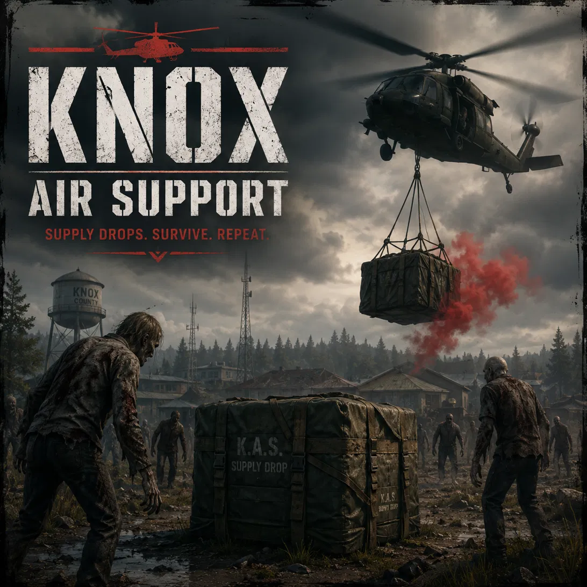

<h1 align="center">
  Knox Air Support
</h1>

<p align="center">
  
  
  
  
  
</p>

<p align="center">
  
</p>

A Project Zomboid mod focused on dynamic air support events, periodic supply drops, and guardian NPC encounters.

## Overview

Knox Air Support adds an event-driven supply drop experience to the game, combining airdrop mechanics, loot rewards, and protective guardian NPCs for a more immersive survival scenario.

## Features

- Periodic air support events with an on-screen notification and a marker on the world map
- **Proximity spawning**: the crate is only materialised once a player gets close to the landing zone, so it always shows up in a loaded chunk
- **Four drop types**, each with its own loot table and its own crate name:

| Type | Crate | Contents |
|---|---|---|
| `food` | Food Supply Crate | Canned food boxes, single cans, rice, bouillon cubes, crackers, dried beans, sugar, salt |
| `medical` | Medical Supply Crate | Needles, antibiotics, bandages, alcohol wipes, sutures, disinfectant, pills, first aid kit |
| `tools` | Utility Supply Crate | Hammers, saws, screwdrivers, nail and screw boxes, metal pipe, welding torch, welding mask, propane tank |
| `weapons` | Weapons Supply Crate | Machete, katana, knives, firearms, ammunition, weapon parts, military bags, vests, helmets, gas masks and filters |

- **Dismantling**: right click a crate and choose *Dismantle supply crate* to salvage it into 1-3 planks, 2-6 screws and 2-4 metal pipes. A looted crate stays in the world and can still be dismantled afterwards.
- Guardian NPC protection during drops (Bandits API, Project A-Life or plain zombies)
- In-game configuration panel with mod integrations
- Sandbox friendly: every value can be set in the sandbox options and overridden in-game

## Dismantling a crate

Right click the supply crate and pick **"Dismantle supply crate"**. The crate is removed
from the world and the player receives the salvage materials. The crate keeps its loot
until it is looted, so you can empty it first and still dismantle it afterwards.

## Carrying crates

The crate is a real world item, so the player can pick it up and carry it with its loot
inside. To avoid hoarding, the crate weighs **25 kg** on its own (plus the weight of
whatever is inside) and its container holds **75 slots** by default. Both the weight and
the capacity are limits on how much a player can stockpile; the capacity is configurable
from the panel and from the sandbox options.

The crate and everything inside it are saved with the player, so closing the game or
reloading the save never loses the loot.

## Textures

The crate model is a `.fbx` plus a single 1024x1024 PNG atlas. The geometry carries the
shape (the bulging tarp, the webbing straps, the cam buckles, the lifting sling) and the
atlas carries the surface (canvas weave, wood grain, rusted metal, worn stencil). PZ
renders models with and without textures (661 of the 1609 vanilla world item models have
no texture at all), so the PNG is optional: without it the crate would show flat colours
per material and **the painted K.A.S. stencil would be gone**. Lower `TEXTURE_WIDTH` and
`TEXTURE_HEIGHT` in the generator to 512 if the 1.4 MB texture feels too heavy.

## Configuration panel

Right click a character (or the supply crate) in the world and choose
**"Knox Air Support: Configuración"**.

The panel lets you toggle the mod integrations and adjust the event settings.
The values are stored in the save data, so they survive restarts.

### Mod integrations

| Integration | What it does |
|---|---|
| **Bandits** | Spawns `Defend` guardians around the crate. Set the guardian count to 0 to disable them. **Has priority** over Project A-Life. |
| **Project A-Life** | Spawns hostile A-Life NPCs in `guard` mode (they hold the crate as their home and defend its radius). Only used when there are no Bandits guardians. |
| **Guns of Marz** | Adds Guns of Marz weapons and weapon parts to the crates. |
| **Snake's ModPack** | Adds Snake's ModPack weapons and accessories (masks, belts,...) to the crates. |

Integrations whose mod is not installed are detected automatically and marked as
*"mod no instalado"* in the panel.

> **Guns of Marz** requires its own dependency (**Gunworks-gang / SWMG**) to be
> enabled as well. If the Bandits mod spams the log with
> `[BANDITS][WARN] Item MarzGuns.* not found!`, Guns of Marz is not enabled in
> the save and the Bandits outfits cannot find their weapons.

## The 3D supply crate

The crate dropped in the world is a real 3D object: an `InventoryItem` with
`WorldStaticModel = KnoxSupplyCrate`, a container with the loot inside and a
2D icon for the inventory.

| File | Purpose |
|---|---|
| `knox_supply_crate_model.py` | Blender script that generates the model and the texture |
| `42/media/models_X/WorldItems/KnoxSupplyCrate.fbx` | The model (PZ format, Y-up, 1 unit = 1 m = 1 tile) |
| `42/media/textures/WorldItems/KnoxSupplyCrate.png` | The texture atlas (512x512) |
| `42/media/textures/Item_KnoxAirSupport/crate.png` | The 2D inventory icon (64x64) |
| `42/media/scripts/knoxairsupport_items.txt` | Item definition (`KnoxAirSupport.KnoxSupplyCrate`) |
| `KnoxSupplyCrate.glb` | Same model exported as glTF (for other tools) |

Regenerating it (needs Blender 4.x/5.x):

```
blender -b -P "C:\ruta\al\mod\knox_supply_crate_model.py"
```

or open the file in Blender's Text Editor and press *Run Script*.

The script reuses the same helper set as the other Blender object scripts
(`caja`, `caja_r`, `esf`, `cil`, `tubo`, `polilinea`, `toro`, `loft`, `prisma`,
`texto`, `mat`, ...), so you can add new primitives without learning a new
idiom. The crate is built as a tarp-covered supply drop: canvas body, metal
corner posts, straps, top rim, parachute cords and the painted *K.A.S. /
SUPPLY DROP* stencil (the stencil is drawn into the texture atlas, PZ uses one
texture per world model).

## Sandbox options

| Option | Default | Description |
|---|---|---|
| Enabled | true | Master kill switch |
| Event Frequency | 180 | Minutes between drops |
| Despawn Timer | 0 | Minutes before the crate disappears. **0 = the crate stays forever** |
| Min / Max Distance | 200 / 800 | Distance range of the landing zone |
| Spawn Radius | 120 | How close a player must get for the crate to appear |
| Guardian Count | 1 | Number of Bandits guardians (0 = none) |
| Loot Quantity | 15 | Maximum number of items per crate |
| Crate Capacity | 75 | Slots the crate can hold (a big military crate is around 75) |
| Priority Chance | 30 | % chance of one special item (suppressor, scope, Snake accessory) |
| Bandits Guardians | true | Enable the Bandits integration |
| Fallback Zombies | true | Spawn plain zombies when there are no Bandits guardians |
| Guns of Marz | true | Enable the Guns of Marz integration |
| Snake's ModPack Weapons | true | Enable the Snake's ModPack integration |
| Show Map Marker | true | Draw the drop on the world map |
| Play Sound | true | Play a sound when the crate lands |

### How the cycle works

* A drop is **announced every `Event Frequency` minutes** (180 by default = 3 hours).
* The crate only materialises when a player gets within `Spawn Radius` tiles of the
  landing zone (that is also what guarantees the chunk is loaded).
* When the next drop is announced, the previous event is closed but **its crate stays
  in the world**. The `Crate Lifetime` (0 = forever) decides when each crate is
  removed, independently from the event cycle.

So with the default settings you get a new drop every 3 hours and the crates pile up
in the world until you loot them.

### Guardians, zombies or just the crate

The guardians are picked in this order:

1. **Bandits** (integration ON and the mod enabled in the save) → `Defend` bandits.
2. **Project A-Life** (integration ON and the mod enabled) → hostile A-Life NPCs in
   `guard` mode, they hold the crate as their home and defend its radius.
3. **Fallback Zombies** (ON) → plain zombies around the crate.
4. Nothing → **only the crate**, no mob at all.

| Bandits integration | Bandits mod | A-Life integration | A-Life mod | Fallback Zombies | Result |
|---|---|---|---|---|---|
| ON | installed | – | – | – | Bandits guards |
| ON | not installed | ON | installed | – | A-Life guards |
| ON | not installed | ON | not installed | ON | zombies |
| OFF | – | ON | installed | – | A-Life guards |
| OFF | – | OFF | – | ON | zombies |
| OFF | – | OFF | – | OFF | only the crate |

## Console commands (singleplayer / server console / RCON)

```
KnoxAirSupport.ForceDrop()            -- random type
KnoxAirSupport.ForceDrop("food")      -- food | medical | tools | weapons
KnoxAirSupport.ForceFoodDrop()        -- shortcut for the food crate
KnoxAirSupport.ForceMedicalDrop()     -- shortcut for the medical crate
KnoxAirSupport.ForceToolsDrop()       -- shortcut for the tools crate
KnoxAirSupport.ForceWeaponsDrop()     -- shortcut for the weapons crate
KnoxAirSupport.ForceDropHere()        -- drop at the player position
KnoxAirSupport.EndEvent()             -- cancel the current event
```

## Installation

1. Place the mod folder into your Project Zomboid mods directory.
2. Enable it in the game launcher (and in the save you are playing).
3. Start a new or existing save and enjoy the added air support events.

## License

MIT License. See [LICENSE](LICENSE) for details.